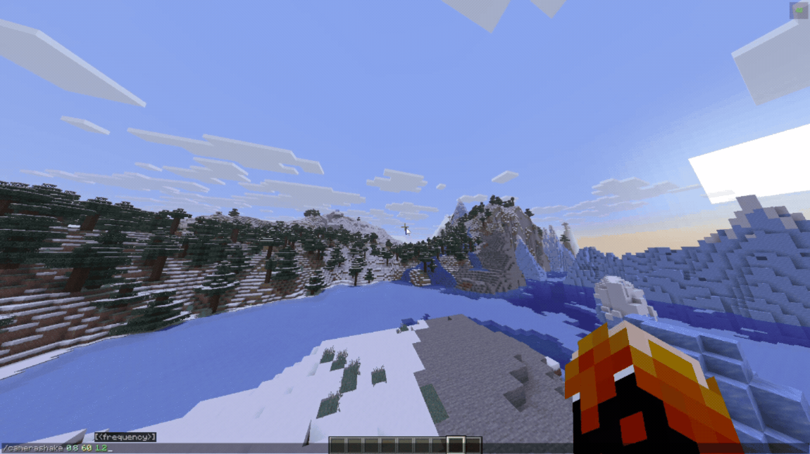
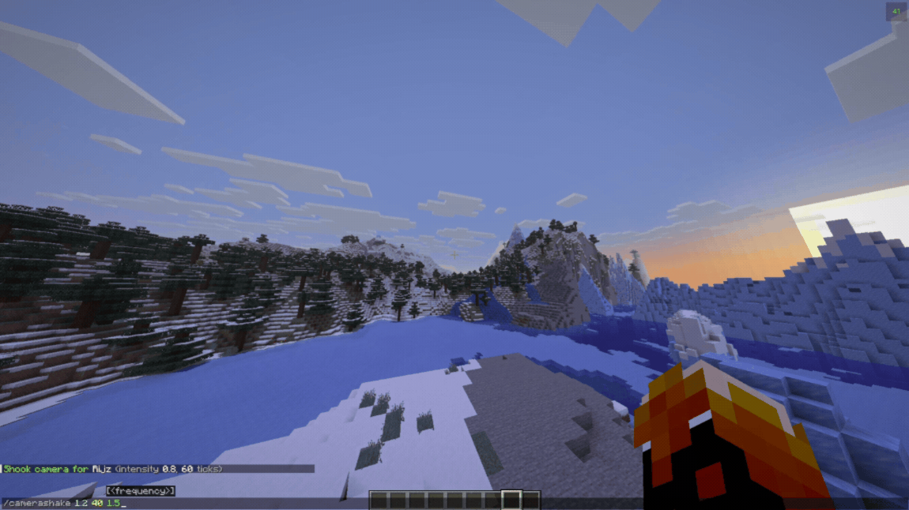
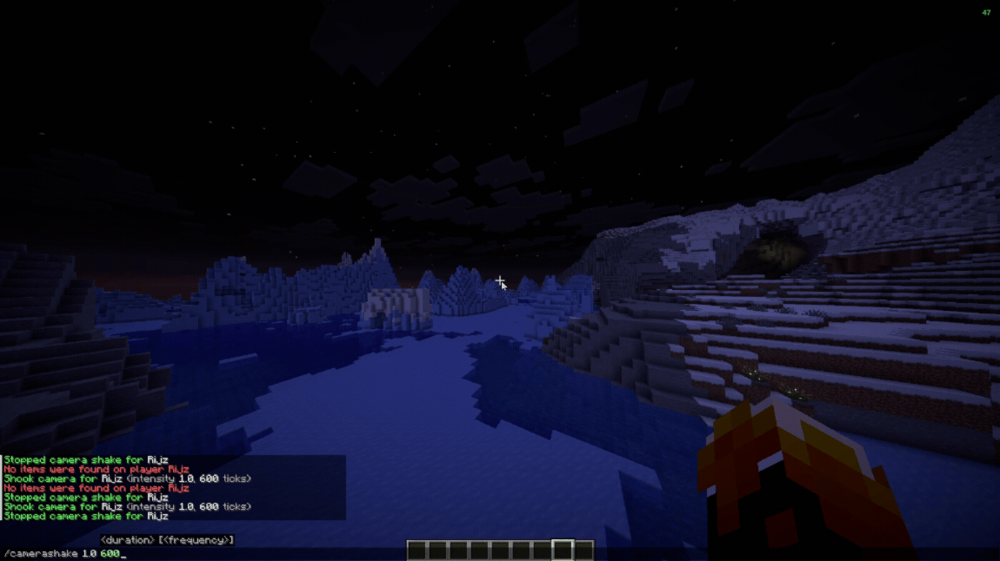

# Camera Shake Lib

A library that lets devs add smooth camera shake effects with a single line of code.

<a href="https://www.curseforge.com/minecraft/mc-mods/camera-shake-lib"></a>
<a href="https://modrinth.com/mod/camera-shake-lib"></a>
<a href="https://github.com/Rijzzz/camera-shake-lib"></a>
<a href="https://discord.com/invite/asPJ4qgs8q"></a>
<a href="https://github.com/Rijzzz/camera-shake-lib/wiki"></a>

## Features

Adds camera shakes on pitch, yaw, and roll without messing with mouse aim. Works in client mods, server mods, and falls back to vanilla tilt if players join without the mod. You can test shakes in game using `/camerashake`.

## Showcase

<details>
<summary>Click to view showcase</summary>







</details>

## Dependencies

Supported on Minecraft 26.1 to 26.3.

### Required

| Name | Version |
| :--- | :--- |
| [Fabric Loader](https://fabricmc.net/) | 0.19.3+ |
| [Fabric API](https://modrinth.com/mod/fabric-api) | 0.155.3+ |

### Optional

| Name | Version |
| :--- | :--- |
| [Mod Menu](https://modrinth.com/mod/modmenu) | 18.0.2+ |

## For Developers

### Gradle Setup

```groovy
repositories {
    exclusiveContent {
        forRepository {
            maven {
                name = "Modrinth"
                url = "https://api.modrinth.com/maven"
            }
        }
        filter {
            includeGroup "maven.modrinth"
        }
    }
}

dependencies {
    implementation "maven.modrinth:camera-shake-lib:1.0.0"
}
```

Check out the [Wiki](https://github.com/Rijzzz/camera-shake-lib/wiki) for a detailed usage guide.

## Support

Need help or found an issue? Join our [Discord](https://discord.com/invite/asPJ4qgs8q) or submit an [Issue](https://github.com/Rijzzz/camera-shake-lib/issues).

## License

Camera Shake Lib is open source under the [MIT License](https://github.com/Rijzzz/camera-shake-lib/blob/master/LICENSE).
